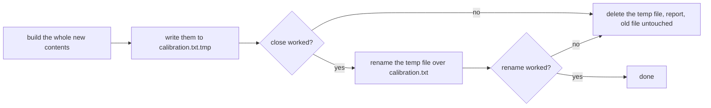

# The Result You Meant to Keep: Writing a File That Is Whole or Not There

> A program wrote 7000 bytes through a stream and was stopped. The file on disk
> was 0 bytes, and the file it had replaced was gone as well.

**Type:** Build
**Time:** about 115 minutes
**Platforms:** Ubuntu 22.04 (GCC 11, Clang 14), Ubuntu 24.04, Windows
**Hardware:** simulated
**Prerequisites:** 01-05, 01-08, 01-12

## The Problem

Lesson 01-12 read a file somebody else wrote. Every program so far has also
ended the same way: it printed something, and when it stopped, the something
was gone.

A robot's useful output is not what it prints. It is the calibration that took
twenty minutes to produce, the poses from a test drive, the only record that
the drive happened. That has to be a file, and the file has to still be there
after the program is stopped, crashes, or is killed by a person who has run out
of patience.

Writing a file looks like the easy direction. Nothing has to be understood, only
produced. It is also where the data is lost, because every way of losing it is
silent.

## The Concept

### It was never opened

```cpp
std::ofstream out("no_such_folder/run.csv");
out << "0.1,1.5\n";
```

Measured on a stream opened on a folder that does not exist:

| | |
| --- | --- |
| threw an exception | **no** |
| `is_open()` | false |
| `good()` after a write | false |

The stream set a flag and then ignored every write it was given. The program
carried on, printed that it had saved, and exited with status 0.

`E-IO-0017`.

### The disk is full, and you find out late

Experiment, method stated: write to `/dev/full`, a Linux device that accepts a
write and answers that the disk is full.

```
after <<:    good() = true
after flush: good() = false
```

The error arrives when the **buffer is emptied**, not when you wrote. So a
program that checks the stream after the last write and not after the flush
reports success, and the data is not there. The place to look is after
`close()`.

### It was emptied by opening it

This is the one that costs most, because it is the ordinary way to write a
file:

```cpp
std::ofstream out("calibration.txt");     // the old contents are gone here
```

Measured: a 27 byte calibration file was **0 bytes** the moment the stream
existed, before a single byte of the new contents had been produced.

From that line until the last byte is written there is no old file and no new
one. The suite models a program that stops five bytes into the new contents:

```
  a calibration file of 27 bytes, opened for writing and
  nothing yet written to it:           0 bytes

  written in place, stopped after 5 bytes: 5 bytes, "offse"
```

Five bytes of a file that was 27, and not the five bytes of either version.

### The rows may never have reached the disk

Experiment, method stated: a program writes 1000 rows of seven bytes each,
7000 bytes, through a stream, and then calls `abort()`.

| how it wrote | on disk after the crash |
| --- | --- |
| rows written to the stream | **0 of 7000 bytes** |
| `std::endl` after each row | **7000 of 7000 bytes** |

The rows were in the stream's buffer, which belongs to the process and dies with
it. Lesson 00-09 measured the same thing for `stdout`: a crash loses what was
waiting, and the line you never saw is not the line it stopped at.

`std::endl` is the right answer for a **log** you want to survive a crash row by
row, and it costs a write per row. It does nothing for a file that has to be
replaced whole.

`E-IO-0018`.

### A file that stops partway can be a valid file

This is the part that makes it dangerous rather than merely annoying. A ten row
log of `0.5,1.5`, stopped after N bytes, read back with lesson 01-12's reader:

```
    stopped at   on disk   rows   unparsable   wrong width   last value
            80        80     10            0             0          1.5
            77        77     10            0             0            1
            13        13      2            0             0            1
            11        11      1            0             1          1.5
             0         0      0            0             0            0
```

Cut after 77 bytes the reader found **ten rows, no bad lines, and a last value
of 1** where the logger meant 1.5. The final row was cut after `0.5,1`, which is
the right width and a perfectly good number. Lesson 01-12 warned that a row cut
short parses as a valid shorter row. This is where it comes from.

Only the cut at 11 bytes, straight after the first field, is noticed at all, and
then only as a row of the wrong width.

### The cure is to not touch the file until the new one is complete



Write beside the real file, not into it. Check that the write completed. Then
rename, which replaces an existing file in one step on Linux and on Windows, so
anything else reading the file sees the old one or the new one and never half of
either.

Measured, with the temporary file blocked so the save has to fail:

```
  saved, with the temporary file blocked:  ok=no, the old file is 27 bytes
  unblocked, saved again:                  ok=yes
```

The old file survives a save that fails. It does not survive a write that fails.

The temporary file is beside the destination because a rename between two drives
is a copy, and a copy is the half-written file again.

### Bytes in, bytes out

The file is opened in **binary** mode. In text mode a stream on Windows turns
every `\n` into two bytes, so the bytes you gave are not the bytes on disk. The
suite saves `a\nb\r\nc` followed by a zero byte and `d`, 8 bytes, and requires 8
on disk. A function taking a C string would have stopped at the zero.

### The number itself

Writing the file safely does not help if the numbers in it are not the numbers
you had.

A stream writes a `double` with six significant digits unless told otherwise.
Measured on 200 values a robot actually has, a running sum of 0.1 and square
roots, written as text and read back:

```
  with the stream's default 6 digits   21 came back identical
  with exact_text                      200 came back identical
```

Two numbers worth knowing, both asked of the compiler rather than remembered:

| | |
| --- | --- |
| `digits10` | **15**. A decimal this long survives being a double. |
| `max_digits10` | **17**. A double this long survives being a decimal. |

So write the shortest text that reads back as the same number: try 15 digits,
then 16, then 17. 2.45 is `2.45`, and `0.1 + 0.2` is `0.30000000000000004`,
because 16 digits give a different double.

Not 17 everywhere. It is always correct and writes 0.1 as
`0.10000000000000001`, which nobody can read and nothing can compare by eye.

`E-NUM-0025`.

`nan` and the infinities are written as those words. Lesson 01-12's reader
refuses all three and counts them, and the suite writes fifty good poses and
one `nan` and gets fifty back and one counted. A value that is not a number
should be reported on the way back in, not turned into one on the way out.

## Build It

Two functions.

`exact_text` handles the values that are not numbers first, then tries 15
digits, then 16, then 17, returning the first text that `std::strtod` reads back
as exactly the same value. The suite pins known answers before it checks
anything else, because a function that always wrote 17 digits would read back
perfectly and fail them.

`save_text` writes to the destination with `.tmp` added, in binary mode, closes
the stream and checks it, renames over the destination with an error code so a
failure is a value rather than an exception, and removes the temporary file on
either failure. It returns a `SaveResult`: whether it worked, and if not, a
sentence that names the file.

The stubs fail by reporting failure and by returning an empty string. Neither
touches a file, and neither can be mistaken for an answer.

## Use It

```cpp
#include <rc/core/save.hpp>

const std::string text = "offset " + rc::core::exact_text(offset) + "\n";

const auto saved = rc::core::save_text("calibration.txt", text);
if (!saved.ok) {
  std::cerr << saved.error << "\n";
  return 1;
}
```

The result has to be looked at to be used, which is the point. Compare the stream
that fails, sets a flag, and waits to be asked.

Two limits worth stating plainly.

**This survives your program dying. It does not survive the power going.** The
rename is atomic as far as other programs are concerned, but the data may still
be in the operating system's cache, and C++17 has no portable way to force it to
disk. That needs `fsync`, which is platform code and a later lesson's work.

**Two programs saving the same file at once will collide** on the temporary
name. Nothing here prevents that.

## What Breaks First

`E-IO-0017` is the write that went nowhere: a stream that never opened, or a disk
that filled up, and the program that said it saved.

`E-IO-0018` is the file that was half written, not written, or not there: opened
and emptied, lost in the buffer, or cut short in a way the reader accepts.

`E-NUM-0025` is the number that read back as a different number, with 15 and 17
and why neither is a round figure.

## Ship It

`rc/core/save.hpp`, in `namespace rc::core`.

From here on, anything this curriculum leaves behind for a later run to read,
a calibration, a recorded pose, a tuned gain, goes through `save_text`, and every
number in it through `exact_text`.
